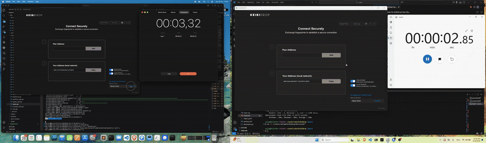
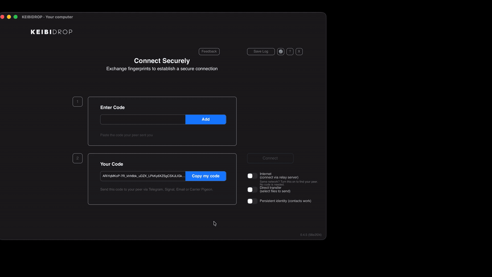
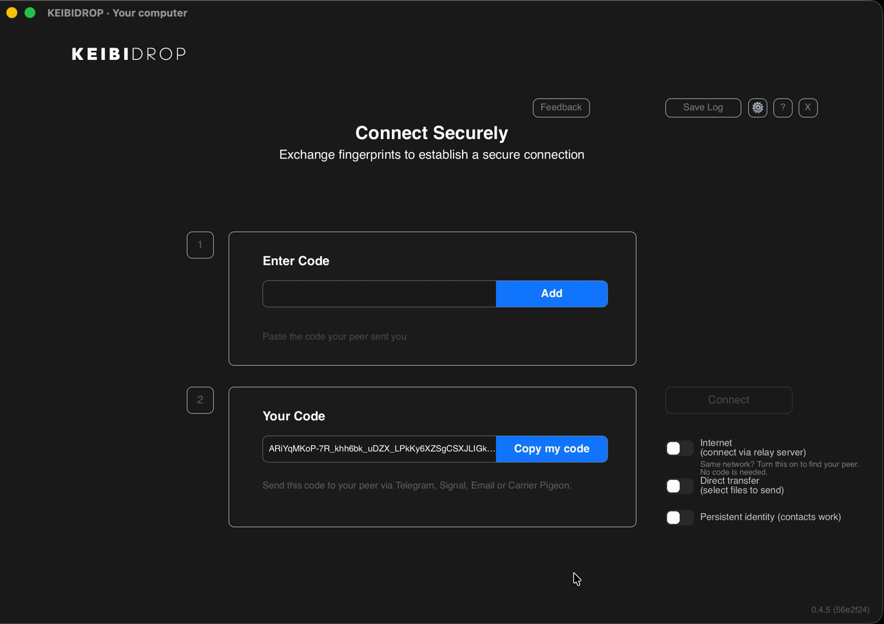
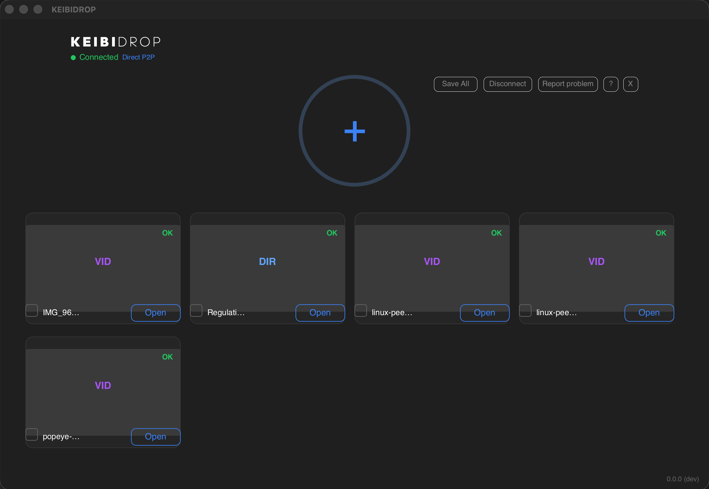
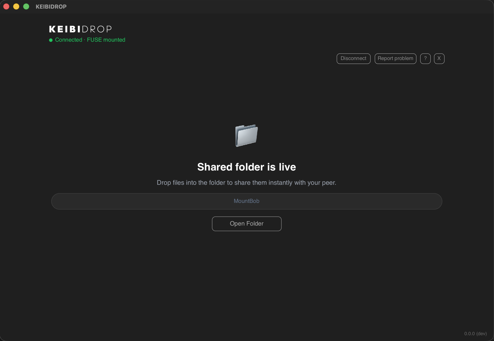
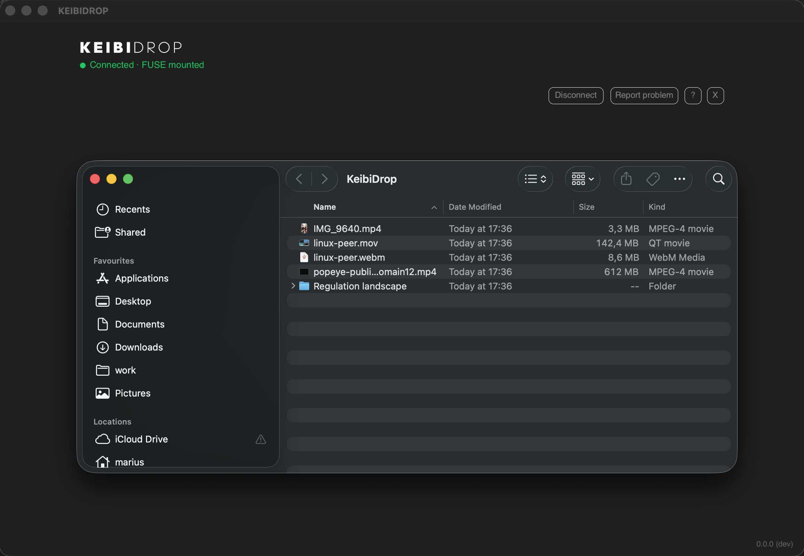
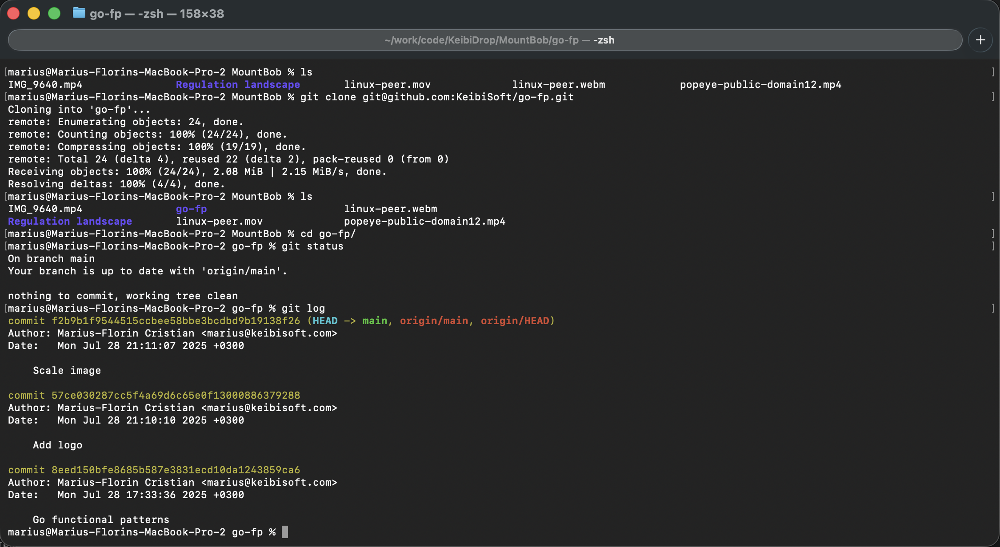
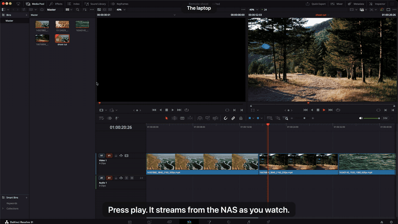
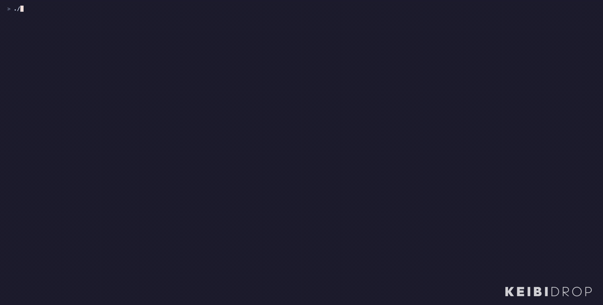
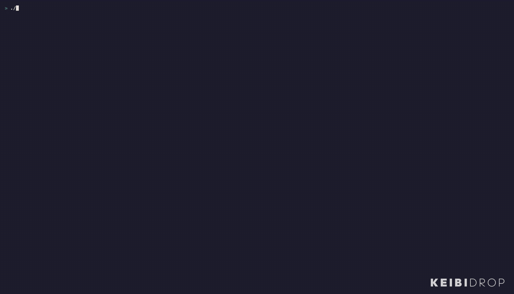

<p align="center">
  <picture>
    <source media="(prefers-color-scheme: dark)" srcset="logo.svg">
    <source media="(prefers-color-scheme: light)" srcset="logo-dark.svg">
    
  </picture>
</p>

<p align="center">
  <a href="https://keibidrop.com">Website</a> · <a href="https://github.com/KeibiSoft/KeibiDrop/releases">Download</a> · <a href="https://keibisoft.com/blog.html">Blog</a>
</p>

<h2 align="center">Open files on another computer without downloading them first</h2>

<p align="center">
  <a href="https://www.youtube.com/watch?v=9Wt0NMx2_I8">
    
  </a>
  <br><sub><b>Mac to Windows, one folder, nothing to download first.</b> Two computers side by side. Click to watch on YouTube, with sound.</sub>
</p>

Another computer's files show up as a folder on yours, and you open and edit them in your own apps with nothing to download first.

- A big file opens right away, because only the parts you read cross the network, and your edits save back.
- No cloud stores your files, and the relay that connects you cannot read them, because they are end-to-end encrypted with protection against future quantum computers.
- On the same network you connect with one click. Over the internet you swap a code once and then save the contact.
- With Teleport on, your friend's files are a real folder on your computer, so any app works with them, `git clone` included.
- It runs on macOS, Linux, Windows and Android, and iOS is on the way. The code is open source under the AGPL-3.0.

**Get it:** [Mac](https://github.com/KeibiSoft/KeibiDrop/releases/download/v0.5.0/keibidrop-0.5.0-darwin-arm64.dmg) · [Windows](https://github.com/KeibiSoft/KeibiDrop/releases/download/v0.5.0/keibidrop-0.5.0-windows-amd64.zip) · [Linux](https://github.com/KeibiSoft/KeibiDrop/releases/download/v0.5.0/keibidrop_0.5.0_amd64.deb) · [Android](https://keibidrop.com/install.html#android) · [every click, per computer](https://keibidrop.com/install.html) · or [try it on the web](https://web.keibidrop.com)

**Jump to:** [Install](#install) · [Quick start](#quick-start) · [Direct transfer and Teleport](#direct-transfer-and-teleport) · [NAS](#run-it-on-a-nas) · [Encryption](#connection-and-encryption) · [By trade](#by-trade) · [Troubleshooting](#troubleshooting)

**Getting started:** install it on both computers and connect once. On the same Wi-Fi, turn on Local mode; anywhere else, send your code in any chat and paste your friend's code. Then drop a file in, or open their files with Teleport. Each step has a [short clip](https://keibidrop.com/how-to-use.html), and the clips are also a [YouTube playlist](https://www.youtube.com/playlist?list=PLB-moSLYtzF0). To open the files on a NAS or a home server, see [Run it on a NAS](#run-it-on-a-nas).

<p align="center">
  <a href="https://www.youtube.com/watch?v=2fIOOnN9HhQ">
    
  </a>
  <br><sub>Copy your code, send it in any chat, paste your friend's code, and both of you press Connect.</sub>
</p>

<p align="center">
  
</p>

| With direct transfer, you drag files in and your friend saves the ones they need. | With Teleport, your friend's files appear as a folder that any app can open. |
|:---:|:---:|
|  |  |

| Finder shows the Teleport Folder like any other folder. | git works inside the Teleport Folder. |
|:---:|:---:|
|  |  |

---

## Install

### macOS

```bash
brew tap keibisoft/keibidrop
brew trust keibisoft/keibidrop
brew install keibidrop
```

### Linux (Debian/Ubuntu)

```bash
wget -O keibidrop.deb $(curl -s https://api.github.com/repos/KeibiSoft/KeibiDrop/releases/latest \
  | grep -o 'https://[^"]*_amd64\.deb')
sudo apt install ./keibidrop.deb
```

### Windows

```bash
choco install keibidrop
```

Or download from [GitHub Releases](https://github.com/KeibiSoft/KeibiDrop/releases).

### Android

We host our own F-Droid repository. Open [fdroid.keibisoft.com](https://fdroid.keibisoft.com) on your phone, scan the code, and check the fingerprint before you add it.

To add it by hand, use `https://fdroid.keibisoft.com/fdroid/repo` in F-Droid under Settings, Repositories. The fingerprint to check is on the same page.

### NAS or home server

On Unraid, open the Apps tab and search for KeibiDrop in Community Applications. On Synology Container Manager, QNAP Container Station or any other Docker host, use `keibisoft/keibidrop` from Docker Hub, or `ghcr.io/keibisoft/keibidrop`. The setup is in [Run it on a NAS](#run-it-on-a-nas).

### Build from source

```bash
git clone https://github.com/KeibiSoft/KeibiDrop.git
cd KeibiDrop
make build-kd       # CLI daemon
make build-cli      # Interactive CLI
make build-rust     # Desktop UI (needs Rust + Slint)
```

---

## Quick start

**On the same network:**
1. You and your friend both open KeibiDrop and turn on Local mode.
2. Your computers find each other.
3. Click your friend's computer to connect.
4. Share files.

**Over the internet:**
1. You and your friend both open KeibiDrop.
2. Copy your code and send it to your friend in any chat.
3. Paste each other's codes and both press Connect.
4. Share files.

Save your friend as a contact to skip the code exchange next time.

KeibiDrop works through firewalls. When a direct connection fails, it uses an encrypted relay, so you need no port forwarding and no router setup.

---

## Direct transfer and Teleport

With direct transfer you add files and your friend saves the ones they need. It needs nothing extra and suits sending large files.

With Teleport your friend's files appear as a folder on your computer, which suits working on shared files and git repositories. It needs a driver installed once: [macFUSE](https://macfuse.github.io/) on a Mac, [fuse3](https://github.com/libfuse/libfuse) on Linux or [WinFsp](https://winfsp.dev/) on Windows.

---

## Run it on a NAS

A NAS or a home server stays online, so it can serve a folder to your computer all the time. The box runs the KeibiDrop container. Your computer opens the box's folder with Teleport, from anywhere, and reads only what it opens.

1. On your computer, install KeibiDrop and the Teleport driver. Open the app, keep Local mode off and press **Copy my code**.
2. On the box, save [docker-compose.yml](docker/docker-compose.yml), set the folder to share and paste your computer's code into `KD_PEER`.
3. Run `docker compose up -d`, then `docker compose logs -f`. The log prints the box's code.
4. On your computer, turn on **Teleport**, paste the box's code and press **Connect**.
5. Press **Save contact** and turn on **Auto** on the contact's row. From then on both sides reconnect by themselves.
6. The box's files now show in your Teleport Folder, `~/KeibiDrop/Mount` by default. Open the files from there in any app. For DaVinci Resolve, follow the [Resolve setup](https://keibidrop.com/docs/how-to/edit-from-a-nas-in-davinci-resolve.html).

The image is on Docker Hub as `keibisoft/keibidrop` and on GHCR as `ghcr.io/keibisoft/keibidrop`, for amd64 and arm64, and Unraid installs it from Community Applications. The container's settings and the limits are in [docker/README.md](docker/README.md), and the full guide is [Run KeibiDrop on a NAS](https://keibidrop.com/docs/how-to/run-on-a-nas.html).

---

## Connection and encryption

1. The two computers exchange codes, or find each other on the local network.
2. KeibiDrop picks the fastest path: the local network, a direct connection or the encrypted relay.
3. Files cross an encrypted channel that the relay cannot read.
4. Keys rotate during the session for forward secrecy.

The encryption is post-quantum (ML-KEM-1024 + X25519) with AES-256-GCM or ChaCha20-Poly1305. Full protocol details in [Security.md](./Security.md).

---

<details>
<summary><strong>Interfaces</strong></summary>

**Desktop UI** (Rust/Slint)
```bash
./keibidrop
```

**Interactive CLI** (terminal REPL)
```bash
./keibidrop-cli
```

**Agent CLI** (for scripts and AI agents, all output is JSON)
```bash
./kd start                           # Start daemon
./kd show fingerprint                # Get your fingerprint
./kd register <peer-fingerprint>     # Register peer
./kd create                          # Create room (or: kd join)
./kd add /path/to/file.zip           # Share a file
./kd list                            # List shared files
./kd pull file.zip ~/Downloads/      # Download a file
```

See [docs/kd-agent-guide.md](./docs/kd-agent-guide.md).

</details>

<details>
<summary><strong>Configuration</strong></summary>

KeibiDrop reads `~/.config/keibidrop/config.toml`. Environment variables override the config.

| Setting | Env var | Default |
|--|--|--|
| Relay server | `KD_RELAY` | `https://keibidroprelay.keibisoft.com/` |
| Bridge relay | `KD_BRIDGE` | `bridge.keibisoft.com:26600` |
| Save folder | `KD_SAVE_PATH` | `~/KeibiDrop/Received/` |
| Teleport Folder | `KD_MOUNT_PATH` | `~/KeibiDrop/Mount/` |
| Inbound port | `KD_INBOUND_PORT` | 26431 |
| Teleport off | `KD_NO_FUSE` | false |

</details>

<details>
<summary><strong>Security</strong></summary>

Post-quantum hybrid key exchange prevents future quantum computers from decrypting recorded traffic. Forward secrecy via periodic re-keying limits exposure if a session key is ever compromised.

By default, identity persists across sessions (so saved contacts keep working), encrypted with a per-install master key stored in the OS keychain (macOS Keychain Services, Linux Secret Service, Windows Credential Manager). Headless setups fall back to `~/.config/keibidrop/.master.key` (mode 0600). A passphrase (Argon2id) can protect it for users who back up the config to a cloud. Incognito mode uses a new key pair for each session and writes nothing to disk, so two sessions cannot be linked.

Full protocol description: [Security.md](./Security.md)

</details>

---

## Troubleshooting

See [TROUBLESHOOTING.md](./TROUBLESHOOTING.md).

## Contributing

See [CONTRIBUTING.md](./CONTRIBUTING.md).

## License

From version 0.5.0 the engine, CLI, mobile bindings and desktop UI are licensed under the [GNU Affero General Public License v3.0](./LICENSE) (AGPL-3.0-only). A closed-source product that embeds or links them needs a commercial license.

Mobile apps and brand assets: Proprietary - see [LICENSING.md](./LICENSING.md)

Desktop UI built with [Slint](https://slint.dev)

Built by [KeibiSoft SRL](https://keibisoft.com).

---

## By trade

### Remote DFIR triage

[](https://youtu.be/Y_4PZcqr4U4)

Mount an evidence share read only across NAT and extract the artifact set you need, with no inbound port, native on Windows, and no kernel driver on the evidence machine. There is a [write-up](https://keibidrop.com/blog/triage-a-remote-machine-without-a-vpn.html) and a [DFIR page](https://keibidrop.com/for/dfir.html).

### Post-production handoff

<p align="center">
  <a href="https://www.youtube.com/watch?v=k8b_6quIqx0">
    
  </a>
  <br><sub>Your footage stays on the studio NAS, and DaVinci Resolve opens it on demand while you travel, with no download or upload to wait for. Click for the two minute demo.</sub>
</p>

[Mount the camera originals](https://keibidrop.com/for/post-production.html) and skip the proxy transcode before the handoff and the relink after it. The [Resolve setup](https://keibidrop.com/docs/how-to/edit-from-a-nas-in-davinci-resolve.html) goes step by step.

### Datasets on a rented GPU box

[Mount the workstation that holds the data](https://keibidrop.com/for/ml.html), with no bucket and no upload before the first batch.

### An always-on box, such as a NAS

<p align="center">
  
</p>

A session needs both machines online, and a NAS or a home server stays online all the time. The container in `docker/` runs the serving side on that box from plain Docker with the stock kernel. Your laptop mounts the folder from anywhere and reads on demand, so only the bytes a program reads cross the wire. In that run the box, a container on a server in Timisoara, served 161 files to a laptop in Bucharest; after it paired once, the laptop listed the folder and hashed one photo. The setup steps are in [Run it on a NAS](#run-it-on-a-nas).

### Photographers and editors

The raws and the footage stay on the box at the studio. The laptop mounts the folder, Lightroom or Resolve opens the files from the mount, and each file moves only when it is opened; a 1 MiB read out of a big file moves one 16 MiB block. The catalog stays on the laptop, as the [post-production page](https://keibidrop.com/for/post-production.html) and the [video and audio guide](https://keibidrop.com/docs/how-to/video-audio-projects.html) describe. Set the share read only when the box is the archive and the laptop must change nothing.

### Agents, and the data they work on

<p align="center">
  
</p>

Two agents, one per machine, each drive a KeibiDrop peer through the MCP server. The laptop offers a folder where it sits, and the gpu box mounts it and checksums 24 shards out of 2,184 files six folders deep. In that run 88,581 bytes crossed the network out of 6,784,286 on disk, because that is what it opened. The whole thing, pairing included, took 12.5 seconds.

Build it with `make build-kdmcp`, then `kdmcp install` prints the config snippet for your MCP client. Sending stays off until `KD_SHARE_ROOT` names one directory to send from, so a receiving agent cannot be talked into shipping files out.

## Links

- [Website](https://keibidrop.com)
- [Documentation](https://keibidrop.com/docs/)
- [Compared with sshfs](https://keibidrop.com/compare/sshfs.html) - measured on a 200 ms link
- [Compared with other tools](https://keibidrop.com/compare/), such as LucidLink, Syncthing, Resilio Sync, rclone, WeTransfer, LocalSend, PairDrop and KDE Connect, one table each
- [Technical deep dive](https://keibisoft.com/tools/keibidrop.html)
- [Engineering blog](https://keibisoft.com/blog.html)
- [FAQ](https://keibisoft.com/tools/keibidrop-faq.html)
- [Comparison with alternatives](https://keibisoft.com/tools/keibidrop-vs-alternatives.html)
- [About and credentials](https://keibidrop.com/about.html)
